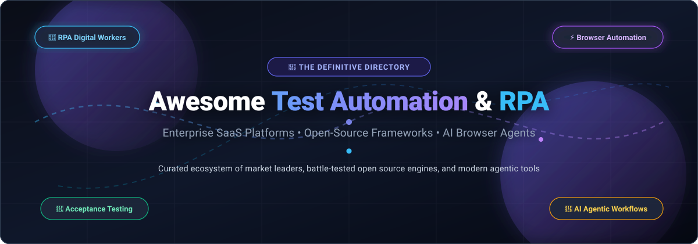
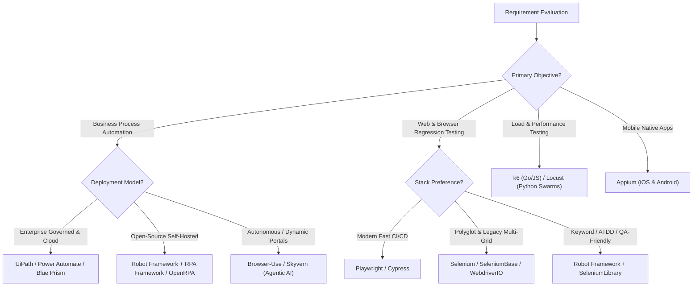

  

# 🤖 Awesome Test Automation & RPA 🧪

  
  
  
  
  
  

---

> 🎯 **A rigorously curated directory of SaaS platforms, enterprise automation suites, battle-tested open-source test engines, and next-generation AI browser automation agents.**

Welcome to the definitive hub for **Test Automation & Robotic Process Automation (RPA)**. This repository tracks both market-leading commercial enterprise platforms and high-velocity open-source solutions that automate digital tasks across web applications, desktop interfaces, APIs, and enterprise systems.

---

## 📑 Table of Contents

- [🌐 Sector Overview & Market Dynamics](#-sector-overview--market-dynamics)
- [🏢 SaaS & Enterprise RPA Platforms](#-saas--enterprise-rpa-platforms)
- [💻 Open-Source Automation & RPA Frameworks](#-open-source-automation--rpa-frameworks)
- [🧩 Ecosystem Architecture & Selection Guide](#-ecosystem-architecture--selection-guide)
- [🤝 How to Contribute](#-how-to-contribute)
- [⭐ Star History](#-star-history)
- [💖 Support & Sponsoring](#-support--sponsoring)
- [📜 Disclaimer](#-disclaimer)

---

## 🌐 Sector Overview & Market Dynamics

The global **Test Automation and Robotic Process Automation (RPA)** sector represents an estimated combined market size exceeding **$35 Billion** in 2026. The dedicated RPA market is valued at approximately **$3.8 Billion to $4.2 Billion** (projected to reach **$15B–$30B+ by 2030** at a ~27% CAGR), while the broader Software Test Automation industry stands at **$31 Billion to $35 Billion** (projected to exceed **$65B+ by 2030**).

The market structure exhibits a distinct **bifurcated concentration**:
- 🏛️ **Enterprise Core (Concentrated / Oligopoly)**: At the Fortune 500 and regulated enterprise tier, the commercial RPA market is **highly concentrated** around top incumbents (Microsoft Power Automate, UiPath, and SS&C Blue Prism capture over 60% of total commercial deployments). Heavy governance barriers, SAP/Citrix legacy support, enterprise credential vaults, and multi-year vendor lock-in create a strong "winner-take-most" advantage for the top players.
- ⚡ **Developer & AI Edge (Moderately Fragmented & Rapidly Evolving)**: Conversely, the end-to-end web testing, headless browser automation, and modern Agentic AI workflow sectors are **moderately to highly fragmented**. Developer preference heavily leans toward open-source frameworks (Playwright, Cypress, Selenium, Robot Framework), while emerging computer-vision and LLM-driven autonomous browser agents (Browser-Use, Skyvern) are rapidly disrupting brittle, selector-based legacy automation bots.

---

## 🏢 SaaS & Enterprise RPA Platforms

The table below lists the major commercial and enterprise SaaS platforms in the Test Automation & RPA ecosystem.
*Entries are sorted in **descending order by company scale (market capitalization, annual revenue, or enterprise valuation)**.*

| 🏷️ Platform & Vendor | 📊 Company Scale (Market Cap / Revenue / Valuation) | 💳 Starting Price | 🎁 Free Tier / Free Trial Limits | 🚀 Key Capabilities & Highlights |
| :--- | :--- | :--- | :--- | :--- |
| **[Microsoft Power Automate](https://powerautomate.microsoft.com/)** | **~$3.1 Trillion** Market Cap • ~$245B Annual Revenue *(NASDAQ: MSFT)* | **$15 / user / month** *(Power Automate Premium, billed annually)*; • Unattended bots: $150 / bot / month | **Free for Windows 11 & M365** *(Power Automate for desktop with standard connectors & local execution)*; • **30-day Free Trial** for Premium cloud flows, premium connectors & AI features | Native Windows 11 integration, cloud DPA workflows, desktop RPA flows, 1,000+ connectors, process mining, and tight integration with Microsoft 365, Teams, and Azure. |
| **[SS&C Blue Prism](https://www.blueprism.com/)** | **~$16.5 Billion** Market Cap • ~$5.5B Annual Revenue *(SS&C Technologies, NASDAQ: SSNC)* | **~$10,000 / bot / year** *(~$833 / bot / month, annual enterprise license)* | **30-day Free Trial** *(1 digital worker, standalone local DB, capped at 15 processes)*; • **90–180-day Learning Edition** *(1 bot, 5 processes, local/standalone only, scheduler disabled)* | Highly secure enterprise control room, centralized multi-tenant digital workforce management, audit logging, and intelligent automation designed for finance and healthcare. |
| **[Pega Robotic Automation](https://www.pega.com/)** | **~$5.5 Billion - $7.0 Billion** Market Cap • ~$1.7B Annual Revenue *(NASDAQ: PEGA)* | **~$90 / user / month** *(Standard Pega Platform user license)*; • RPA bot runtimes start at ~$8,000 / bot / year | **30-day Free Trial** *(Pega Community Edition cloud sandbox, single developer environment, non-production evaluation)* | Attended desktop automation, unattended server bots, self-healing UI controls, unified with Pega Case Management, real-time AI decisioning engine, and workflow orchestration. |
| **[UiPath](https://www.uipath.com/)** | **~$6.5 Billion** Market Cap • ~$1.4B Annual Recurring Revenue *(NYSE: PATH)* | **$25 / month** *(Basic Plan)*; • Pro Plan: $420 / month *(1 attended + 1 unattended bot, 25k units)* | **Free Forever Community Edition** *(For individuals/small business &lt;250 users, &lt;$5M rev: Studio/StudioX, 2 attended bots, 1 unattended bot, 8,000 units/mo)*; • **60-day Enterprise Trial** | Category-defining enterprise RPA suite with Studio IDE, Studio Web, AI Document Understanding, Automation Hub, process mining, test suite automation, and autonomous AI agents. |
| **[Appian RPA](https://appian.com/)** | **~$3.1 Billion** Market Cap • ~$800M Annual Revenue *(NASDAQ: APPN)* | **~$75 - $90 / user / month** *(Standard tier, typically bundles up to 5 RPA bots)* | **Free Forever Community Edition** *(1 personal cloud dev environment, full access to Appian low-code designer & prototype bots, non-production use)* | Low-code process automation platform with built-in robotic process automation bots, unified Data Fabric across enterprise silos, complex case management, and AI business rules. |
| **[Automation Anywhere](https://www.automationanywhere.com/)** | **~$3.0 Billion** Valuation • ~$500M+ Annual Revenue *(Backed by SoftBank & Salesforce)* | **~$750 / month** *(~$9,000 / year Cloud Starter pack billed annually)*; • Enterprise custom | **Free Forever Community Edition** *(For small business &lt;250 users, &lt;$5M rev: up to 5 machines, 1 Bot Creator, 1 Attended Runner, 100 Document AI pages/month)*; • **30-day Enterprise Trial** | Cloud-native Automation 360 platform, generative AI Prompt-to-Automate, Document Automation (IQ Bot) for unstructured data, Bot Insight real-time analytics, and Co-Pilot integrations. |
| **[Kofax RPA (Tungsten Automation)](https://www.tungstenautomation.com/)** | **~$3.0 Billion** Valuation • ~$600M - $1.0B Annual Revenue *(Clearlake & TA Associates buyout)* | **~$3,500 - $5,000 / bot / year** *(or entry platform package from ~$25,000 / year)* | **10-day Structured Evaluation Trial** *(Sales-coordinated proof-of-concept sandbox, restricted environment with capped cognitive document OCR pages)* | Synthetic API generation, robot-based screen scraping without DOM dependencies, cognitive document processing, and TotalAgility enterprise process orchestration. |
| **[Nintex](https://www.nintex.com/)** | **~$2.0 Billion** Valuation • ~$250M Annual Recurring Revenue *(Acquired by TPG Capital)* | **~$625 / month** *(Standard module)*; • Nintex Pro Platform from ~$25,000 / year *(~$2,083 / month)* | **30-day Free Trial** *(No credit card required; full access to workflow designer, digital forms, RPA bot studio, and doc generation, non-production)* | Visual drag-and-drop process mapping (Promapp), desktop RPA bots, automated document generation, mobile forms, and enterprise workflow automation across SharePoint/Salesforce. |
| **[WorkFusion](https://www.workfusion.com/)** | **~$1.2 Billion** Valuation • ~$80M - $100M Annual Recurring Revenue *(Unicorn)* | **~$500 - $1,250 / month** *(Packaged modular AI worker tiers)*; • Enterprise solutions from ~$30,000 / year | **30-day Guided PoC Trial** *(Sales-assisted evaluation instance, limited to test datasets and capped at 100 sample documents/transactions)* | Specialized pre-built AI "Digital Workers" designed specifically for banking and financial services: anti-money laundering (AML), adverse media monitoring, KYC screening, and sanction checks. |
| **[AutomationEdge](https://automationedge.com/)** | **~$75 Million - $100 Million** Valuation • ~$20M Annual Revenue *(Privately held)* | **$25 / month** *(Pay-as-you-go consumption model for starter RPA & ITPA)* | **Free Forever F3 RPA Bot** *(1 free robot runtime, core automation actions, cloud or on-premise development, capped monthly execution minutes)* | Unified hyperautomation platform combining robotic process automation, IT Process Automation (ITPA), Document AI, Conversational AI chatbots, and spreadsheet/ETL automation. |

---

## 💻 Open-Source Automation & RPA Frameworks

Open-source automation frameworks form the backbone of modern developer tooling, continuous integration (CI/CD) pipelines, regression testing suites, and autonomous browser agents.

*All repositories are sorted in **descending order by GitHub Stars_Count**. Click the Stars_Badge beside any repository to inspect its live stargazers on GitHub.*

| 📦 Repository & Framework | ⭐ GitHub_Stars (Live Badge) | 🛠️ Primary Category | 💻 Language / Ecosystem | 🎯 Core Focus & Key Strengths |
| :--- | :--- | :--- | :--- | :--- |
| **[Browser-Use](https://github.com/browser-use/browser-use)** |  | AI Browser RPA Agent | Python | Connects LLMs (GPT-4o, Claude 3.5, Gemini) directly to headless browsers to execute human-like web actions, extract complex dynamic data, and solve multi-step web tasks without fixed selectors. |
| **[Playwright](https://github.com/microsoft/playwright)** |  | E2E Browser Test Automation | TypeScript / Node.js, Python, Java, C# | Modern standard for web automation across Chromium, WebKit, and Firefox. Features resilient auto-waiting, network interception, Trace Viewer, and native headless execution. |
| **[Puppeteer](https://github.com/puppeteer/puppeteer)** |  | Headless Browser Automation | JavaScript / Node.js | Google Chrome team's official Node.js library for controlling Chrome and Chromium over the DevTools Protocol. Premier choice for web scraping, PDF generation, and automated auditing. |
| **[Cypress](https://github.com/cypress-io/cypress)** |  | Web Application E2E Testing | JavaScript / TypeScript | Fast, developer-friendly browser testing framework that runs directly inside the browser run loop. Delivers time-travel debugging, readable assertions, and instant test reloads. |
| **[Selenium](https://github.com/SeleniumHQ/selenium)** |  | Cross-Browser Web Automation | Java, Python, C#, JavaScript, Ruby | The foundational W3C-standardized browser automation framework. Unmatched language versatility, massive global plugin ecosystem, and deep legacy grid infrastructure support. |
| **[k6](https://github.com/k6io/k6)** |  | Performance & Load Testing | Go / JavaScript | High-performance developer-centric load testing tool by Grafana Labs. Write test scripts in modern ES6 JavaScript and execute at massive scale with minimal CPU and memory overhead. |
| **[Locust](https://github.com/locustio/locust)** |  | User Load & Stress Testing | Python | Highly scalable, code-driven load testing framework where user behavior is defined in idiomatic Python code. Features real-time web UI, distributed swarm testing, and flexible hooks. |
| **[Skyvern](https://github.com/Skyvern-AI/skyvern)** |  | Autonomous AI Web RPA | Python | AI-era open-source alternative to UiPath. Uses computer vision and multimodal LLMs to navigate dynamic web pages, bypass layout changes, and complete forms without brittle XPath locators. |
| **[Appium](https://github.com/appium/appium)** |  | Mobile App Test Automation | Multi-language (WebDriver protocol) | Standard cross-platform automation framework for iOS, Android, and Windows apps without modifying source code. Bridges native, hybrid, and mobile web automation. |
| **[SeleniumBase](https://github.com/SeleniumBase/SeleniumBase)** |  | All-in-One Python Automation | Python | Unified Python framework integrating Selenium, pytest, and UC (undetected-chromedriver) mode. Simplifies complex selectors, handles CAPTCHAs/Cloudflare challenges, and produces visual reports. |
| **[Robot Framework](https://github.com/robotframework/robotframework)** |  | Keyword-Driven RPA & Testing | Python | Generic open-source keyword-driven automation framework. Plain-text syntax readable by non-programmers, easily extended with 80+ RPA libraries (RPA Framework, SeleniumLibrary, AppiumLibrary). |
| **[WebdriverIO](https://github.com/webdriverio/webdriverio)** |  | Next-Gen E2E Test Runner | JavaScript / TypeScript | Modern end-to-end and component test runner for browser and mobile apps. Compatible with WebDriver and Chrome DevTools protocols with native support for Electron and mobile emulators. |
| **[TagUI](https://github.com/kelaberetiv/TagUI)** |  | CLI & Natural-Language RPA | Python, JavaScript | Free open-source command-line RPA tool that translates simple English commands (`click`, `type`, `read`, `snap`) into automated browser and desktop steps. Perfect for lightweight scheduled scripts. |
| **[Automagica](https://github.com/automagica/automagica)** |  | Python Desktop & Web RPA | Python | Clean Python automation framework providing native APIs to automate desktop windows, Excel workbooks, Word docs, PDF forms, and web browser workflows with minimal lines of code. |
| **[OpenRPA](https://github.com/open-rpa/openrpa)** |  | Visual Open-Source RPA | C# / Windows Workflow Foundation | Closest open-source visual alternative to enterprise UiPath. Built for Windows with visual drag-and-drop workflow designer, element inspectors, recording tools, and OpenFlow cloud orchestrator. |
| **[Taskt (sharpRPA)](https://github.com/saucepleez/taskt)** |  | .NET Desktop RPA Studio | C# (.NET) | Free and open-source visual automation designer on Windows. Allows users to construct automations using pre-built command blocks without requiring deep programming expertise. |
| **[Robocorp](https://github.com/robocorp/robocorp)** |  | Python-Native RPA & AI Automation | Python | Python-first automation developer stack and VS Code tooling designed around `tasks.py` and `robot.yaml`. Acquired by Sema4.ai to power enterprise Agentic AI workflows. |

---

## 🧩 Ecosystem Architecture & Selection Guide

To assemble an optimal automation stack for your team, refer to the following architectural matrix:

---

## 🤝 How to Contribute

Contributions are warmly welcomed! Help keep this directory accurate, objective, and comprehensive:

1. 🍴 **Fork** the repository: [ishandutta2007/Awesome-Test-Automation-RPA](https://github.com/ishandutta2007/Awesome-Test-Automation-RPA).
2. 🌿 **Create a new branch**: `git checkout -b add-tool-name`.
3. 📝 **Add your entry**:
   - Maintain alphabetical or star-count sorting where appropriate.
   - For SaaS tools: provide verifiable pricing and exact free tier/trial limits.
   - For Open-source repos: include official links and accurate categorization.
4. 📬 **Submit a Pull Request** with a concise description of why the tool adds value to the community.

Check out [Awesome-Awesome-Awesome](https://github.com/ishandutta2007/Awesome-Awesome-Awesome) for more curated tech lists!

---

## ⭐ Star History

---

## 💖 Support & Sponsoring

Thank you for visiting and supporting the **Awesome Test Automation & RPA** ecosystem! 🚀

If you found this curated directory helpful, please consider supporting the project:
- ⭐ **Star** this repository to help others discover it.
- 🍴 **Fork** and contribute new tools or updates via pull requests.
- 📢 **Share** with fellow QA engineers, test developers, and RPA practitioners.
- ☕ **Sponsor & Buy a Coffee**: Support ongoing maintenance and curated updates directly via the [GitHub Sponsor Dashboard](https://github.com/sponsors/ishandutta2007).

  

---

## 📜 Disclaimer

- This repository is a community-curated list compiled for educational, architectural, and informational purposes. It is not an endorsement or sponsorship of any commercial product.
- **Compliance with Terms of Service**: Automating third-party applications, websites, and APIs must strictly adhere to each service's respective Terms of Service (ToS), robots.txt directives, and anti-abuse regulations. Web scraping or bypassing security protections without explicit authorization may violate legal policies.
- Self-hosted open-source RPA solutions require robust credential encryption, least-privilege service accounts, and sandboxed runtimes for production reliability.

---

  <b>Built with ❤️ for QA Engineers, Test Automation Developers, RPA Practitioners &amp; System Architects worldwide.</b>

